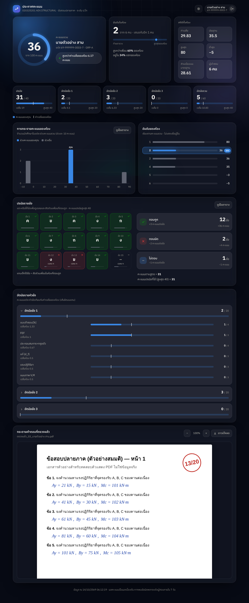
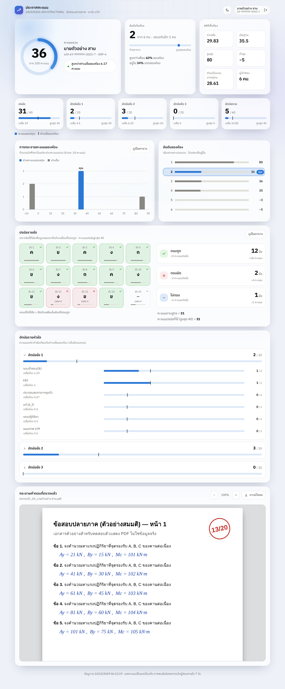
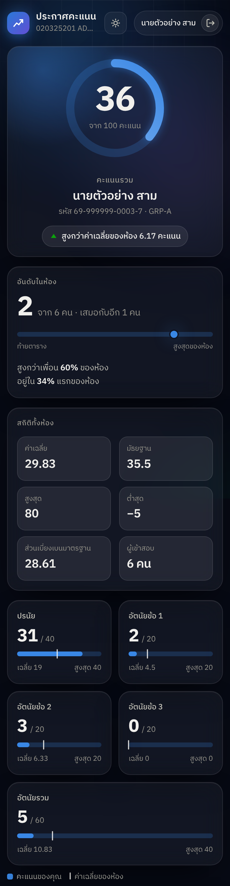
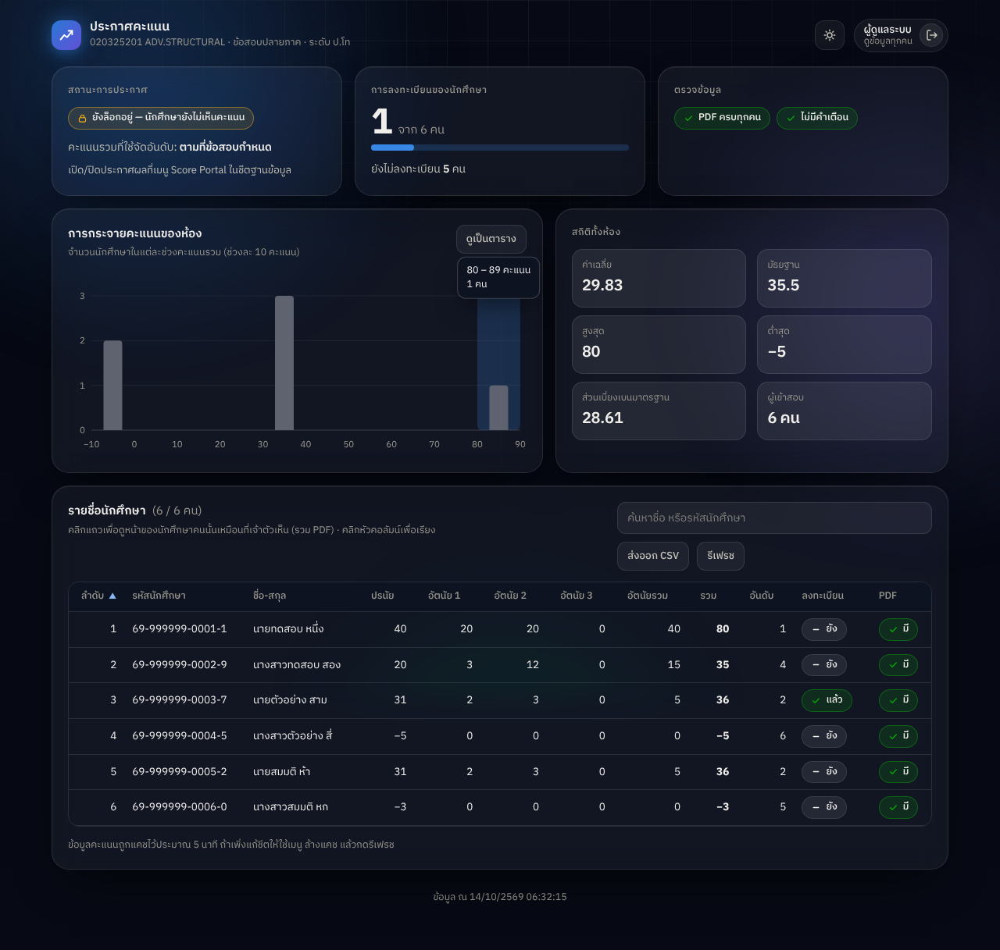

# Score Portal — ระบบประกาศคะแนนสำหรับนักศึกษา

เว็บแอปบน **Google Apps Script** ที่ส่งลิงก์เดียวให้นักศึกษาได้ นักศึกษาลงทะเบียนด้วยรหัสนักศึกษาและตั้งรหัสผ่านเอง
แล้วดูคะแนนรวม คะแนนรายข้อ อันดับในห้อง และไฟล์ PDF กระดาษคำตอบที่ตรวจแล้วของตัวเองเท่านั้น
ฐานข้อมูลผู้ใช้เก็บใน Google Sheets ข้อมูลคะแนนอ่านจากชีตสรุปคะแนนของผู้สอนโดยตรง (แก้ชีตแล้วหน้าเว็บอัปเดตเอง)

ออกแบบตามโครงสร้างของไฟล์ `สรุปคะแนน_ข้อสอบปลายภาค ป.โท (ร่าง).xlsx` และโฟลเดอร์ PDF `ตรวจแล้ว_<ลำดับ>_<ชื่อ-สกุล>.pdf`

> ⚠️ ไฟล์สรุปคะแนนต้นฉบับระบุว่าเป็น **ฉบับร่างให้ผู้สอนตรวจทาน** ระบบจึงตั้งค่าเริ่มต้นเป็น **ปิดประกาศผล**
> นักศึกษาลงทะเบียนได้ แต่จะยังไม่เห็นคะแนนจนกว่าผู้สอนสั่ง "เปิดประกาศผล"

## สิ่งที่นักศึกษาเห็น

| ส่วน | รายละเอียด |
|---|---|
| ล็อกอิน / ลงทะเบียน | รหัสนักศึกษา + รหัสผ่านที่ตั้งเอง (ลงทะเบียนครั้งเดียว ยืนยันตัวตนด้วยชื่อ-สกุลหรือรหัสยืนยัน) |
| คะแนนรวม | วงแหวนคะแนน เทียบค่าเฉลี่ยห้อง |
| อันดับ | อันดับในห้อง (อันดับเสมอใช้เลขเดียวกัน), % ของเพื่อนที่คะแนนต่ำกว่า, สถิติห้อง (เฉลี่ย/มัธยฐาน/สูงสุด/ต่ำสุด/SD) |
| คะแนนรายส่วน | ปรนัย (/40), อัตนัยข้อ 1–3 (/20), อัตนัยรวม (/60) พร้อมเส้นค่าเฉลี่ยห้อง |
| กราฟ | การกระจายคะแนนของห้อง (จุดที่นักศึกษาอยู่), กระดานอันดับแบบไม่ระบุชื่อ — มีมุมมองตารางทุกกราฟ |
| ปรนัยรายข้อ | คำตอบ/เฉลย/ถูก-ผิด-ไม่ตอบ รายข้อ + สัดส่วนเพื่อนที่ตอบถูก |
| อัตนัยรายหัวข้อ | คะแนนแต่ละหัวข้อย่อยเทียบค่าเฉลี่ยห้อง |
| PDF | แสดงกระดาษคำตอบที่ตรวจแล้วในหน้า (pdf.js) ซูมและดาวน์โหลดได้ |
| ความเห็นรายข้อ | ปิดเป็นค่าเริ่มต้น (เปิดที่ `show_feedback`) |

ธีมมืด/สว่างสลับได้ รองรับมือถือ

### ตัวอย่างหน้าตา (ข้อมูลสมมติ)






## ติดตั้ง (ทำครั้งเดียว ~10 นาที — คัดลอกวางเพียง 3 ไฟล์จากโฟลเดอร์ `dist/`)

1. **เตรียมไฟล์คะแนน:** เปิดไฟล์ `สรุปคะแนน_...xlsx` ใน Drive › **File › Save as Google Sheets** (ได้ไฟล์ใหม่ชนิด Google Sheets)
2. สร้าง Google Sheets ใหม่ ตั้งชื่อ `ScorePortal_DB` (เก็บบัญชีผู้ใช้ **อย่าแชร์ให้ผู้อื่น**) ด้วยบัญชีที่จะใช้ Deploy
   — แนะนำบัญชี Gmail ส่วนตัวที่มีสิทธิ์ในโฟลเดอร์ PDF (บัญชีองค์กรบางแห่งปิดตัวเลือก "Anyone")
3. **Extensions › Apps Script** แล้ววางโค้ด 3 ไฟล์ (เปิดไฟล์ใน GitHub กด *Copy raw file*):
   - `dist/Code.gs` → วางทับเนื้อหาไฟล์ `Code.gs` ที่มีอยู่ (ลบโค้ดเดิมทิ้งก่อน)
   - `dist/Index.html` → กด **+** ข้าง Files › **HTML** ตั้งชื่อ `Index` (พิมพ์ใหญ่ตัว I) แล้ววาง
   - `dist/appsscript.json` → ที่ Project Settings (รูปเฟือง) ติ๊ก **Show "appsscript.json" manifest file in editor** แล้วกลับไปวางทับไฟล์ `appsscript.json`
   กด Save (ไอคอนแผ่นดิสก์)
4. กลับไปที่ชีต `ScorePortal_DB` แล้วรีเฟรชหน้า จะมีเมนู **Score Portal** (รอสักครู่ถ้ายังไม่ขึ้น) กดตามลำดับ:
   - **1) ตั้งค่าเริ่มต้น** — ครั้งแรก Google จะขออนุญาต: *Review permissions › เลือกบัญชี › Advanced › Go to ... (unsafe) › Allow* (ขึ้นแบบนี้กับสคริปต์ที่เขียนเอง)
   - **2) วางลิงก์ไฟล์คะแนนและโฟลเดอร์ PDF** — วางลิงก์ไฟล์ Google Sheets จากข้อ 1 และลิงก์โฟลเดอร์ PDF ระบบตรวจข้อมูลให้ทันทีและรายงานสิ่งที่ผิดปกติ
   - **3) ตั้งรหัสผ่านผู้ดูแล** — ตั้งรหัสสำหรับหน้าผู้ดูแล (ดูหัวข้อถัดไป)
5. **Deploy › New deployment** › รูปเฟือง **Select type › Web app** — *Execute as*: **Me**, *Who has access*: **Anyone** › Deploy
   คัดลอก **Web app URL ที่ลงท้าย `/exec`** นี่คือลิงก์ที่ส่งให้นักศึกษา (ห้ามใช้ลิงก์ `/dev`)
6. ทดสอบด้วยแถวนักศึกษาทดสอบ (เพิ่มชั่วคราวในแท็บ `สรุปคะแนน`) หรือเปิดหน้าผู้ดูแลดูข้อมูลจริง
7. เมื่อผู้สอนตรวจทานคะแนนแล้ว: เมนู **เปิดประกาศผล**

> บัญชีที่ Deploy ต้องอ่านโฟลเดอร์ PDF และชีตคะแนนได้ — ระบบอ่านไฟล์ในนามบัญชีนี้ นักศึกษาไม่ต้องมีสิทธิ์เข้า Drive
> เมื่อแก้โค้ดภายหลัง: รัน `npm run bundle` วางไฟล์ใน `dist/` ใหม่ แล้ว **Deploy › Manage deployments › ✏️ › New version › Deploy** (URL เดิม)
> ไฟล์แยกในโฟลเดอร์หลัก (`Config.gs`, `Lib.gs`, ...) คือโค้ดต้นฉบับสำหรับพัฒนา; `dist/` สร้างจากไฟล์เหล่านั้นอัตโนมัติ และเทสต์จะแจ้งถ้า `dist/` ล้าสมัย

## หน้าผู้ดูแล (Admin) — ดูข้อมูลของนักศึกษาทุกคน

1. เมนู **Score Portal › 3) ตั้งรหัสผ่านผู้ดูแล** แล้วพิมพ์รหัสผ่านกลางที่ต้องการ (เช่น `1111`)
   ระบบแสดง **ลิงก์ผู้ดูแล** รูปแบบ `https://script.google.com/macros/s/.../exec?admin=<คีย์ลับ>`
   (เรียกดูอีกครั้งที่เมนู **แสดงลิงก์ผู้ดูแล**; ต้อง Deploy เป็น Web app แล้วจึงมี URL เต็ม และเมื่อวางโค้ดใหม่ต้อง Deploy เวอร์ชันใหม่)
2. เปิดลิงก์ผู้ดูแล → กรอกรหัสผ่านผู้ดูแล → เห็น
   - สถานะประกาศผล, จำนวนนักศึกษาที่ลงทะเบียนแล้ว, ตรวจข้อมูล (ไม่พบ PDF/คำเตือนจากชีต)
   - กราฟกระจายคะแนนและสถิติห้อง
   - **ตารางนักศึกษาทุกคน** (คะแนนรายส่วน รวม อันดับ ลงทะเบียนหรือยัง มี PDF หรือไม่) ค้นหาด้วยชื่อ/รหัส เรียงตามคอลัมน์ ส่งออก CSV
   - คลิกแถว (หรือพิมพ์รหัสแล้วกด Enter) → เปิดหน้าของนักศึกษาคนนั้นเหมือนที่เจ้าตัวเห็น รวมกระดาษคำตอบ PDF และความเห็นรายข้อ
     ผู้ดูแลเห็นได้แม้ยังไม่เปิดประกาศผล (มีแถบ "โหมดผู้ดูแล" บอกสถานะ)
3. หน้าผู้ดูแลเป็นแบบอ่านอย่างเดียว ไม่แก้คะแนน; การเข้าสู่ระบบและการเปิดดูนักศึกษา/PDF แต่ละครั้งถูกบันทึกในแท็บ `Audit`
   หน้านี้ไม่แสดงคอลัมน์บันทึกภายใน "ข้อควรพิจารณา" ของ Excel (ถ้าต้องการอ่านให้เปิดในชีตคะแนนโดยตรง)

**ทำไมรหัสกลางไม่ใช้บนหน้าล็อกอินของนักศึกษา:** ถ้าหน้าล็อกอินปกติยอมรับรหัสกลาง เช่น `1111` กับรหัสนักศึกษาใดก็ได้
เพื่อนในห้องแค่ลองรหัสนี้ก็เปิดคะแนนและกระดาษคำตอบของทุกคนได้ (ล็อกบัญชีก็ไม่ช่วย เพราะลองครั้งเดียวก็สำเร็จ)
ระบบนี้จึงให้รหัสกลางใช้ได้เฉพาะผู้ที่มี **ลิงก์ผู้ดูแลที่มีคีย์ลับ 128 บิต** และล็อกอัตโนมัติ 15 นาทีเมื่อกรอกผิด 5 ครั้งติด
รหัสกลางจึงสั้นได้โดยยังปลอดภัย *ตราบใดที่ไม่แชร์ลิงก์ผู้ดูแล* — ถ้าลิงก์รั่ว ใช้เมนู **สร้างลิงก์ผู้ดูแลใหม่** (ลิงก์เดิมและเซสชันเดิมใช้ไม่ได้ทันที)
แนะนำให้ใช้รหัสที่ยาวกว่า 4 หลักถ้าจะเปิดลิงก์บนเครื่องที่ผู้อื่นใช้ร่วม

## การตั้งค่า (แท็บ `Settings`)

| key | ค่าเริ่มต้น | ความหมาย |
|---|---|---|
| `published` | FALSE | เปิด/ปิดประกาศผล |
| `scores_spreadsheet_id` | (ว่าง) | ID ชีตสรุปคะแนนที่แปลงแล้ว |
| `pdf_folder_id` | (ว่าง) | ID โฟลเดอร์ PDF ที่ตรวจแล้ว |
| `total_mode` | `official` | คะแนนรวมที่ใช้แสดง/จัดอันดับ: `official` (ตามข้อสอบกำหนด) · `mcq_floor0` (ปรนัยขั้นต่ำ 0) · `no_partial_q2` (ข้อ 2 ไม่ให้คะแนนบางส่วน) |
| `register_verify` | `name` | `name` = รหัส+ชื่อ-สกุล · `code` = รหัสยืนยันรายคน (แนะนำ) |
| `show_leaderboard` | TRUE | กราฟกระจายคะแนน + กระดานอันดับ (ไม่แสดงชื่อ) |
| `show_feedback` | FALSE | ความเห็นรายข้อ (ตรวจข้อความก่อนเปิด) |
| `show_pdf` | TRUE | แสดง PDF |
| `notice` | (ว่าง) | ข้อความประกาศ |
| `course_title`, `course_subtitle`, `session_hours`, `min_password_length` | | ตามชื่อ |

เมนูผู้สอน: ตั้งค่าเริ่มต้น · วางลิงก์ไฟล์คะแนน/โฟลเดอร์ PDF · ตรวจสอบข้อมูล · เปิด/ปิดประกาศผล · ตั้งรหัสผ่านผู้ดูแล / แสดงลิงก์ผู้ดูแล / สร้างลิงก์ผู้ดูแลใหม่ · สร้างรหัสยืนยันรายคน · รีเซ็ตรหัสผ่านนักศึกษา (ลืมรหัสผ่าน) · ล้างแคช (แคชข้อมูลคะแนน 5 นาที)

## ข้อมูลที่ระบบคาดหวัง (อ่านจาก "ข้อความหัวตาราง" ไม่ใช่ตำแหน่งคอลัมน์)

| แท็บ | หัวตารางที่ใช้ |
|---|---|
| `สรุปคะแนน` | ลำดับ · รหัสนักศึกษา · ชื่อ-สกุล · ปรนัยถูก/ปรนัยผิด/ไม่ตอบ · ปรนัยที่ใช้ (สูงสุด 40) · อัตนัยข้อ 1–3 (20) · อัตนัยรวม · คะแนนรวม (100) · รวม ถ้าปรนัยขั้นต่ำ 0 · รวม ถ้าข้อ 2… · ไฟล์ PDF ที่ตรวจแล้ว |
| `ปรนัยรายข้อ` | ลำดับ · ชื่อ-สกุล · ข้อ 1…ข้อ 15 + แถวใต้หัวตารางที่มีคำว่า "เฉลย" |
| `อัตนัยรายข้อ` | ลำดับ · ชื่อ-สกุล · `ข้อ1 <หัวข้อ>`… · `ข้อ 1 รวม` + แถว "คะแนนเต็ม" |
| `ข้อควรพิจารณา` | ลำดับ · ชื่อ-สกุล · ข้อ · ความเห็น |

แท็บ ปรนัย/อัตนัย/ความเห็น ขาดได้ (ระบบข้ามส่วนนั้น) แต่แท็บ `สรุปคะแนน` จำเป็น
PDF จับคู่จากช่อง "ไฟล์ PDF ที่ตรวจแล้ว" ก่อน ถ้าไม่เจอจะลองจับคู่ด้วย `ตรวจแล้ว_<ลำดับ 2 หลัก>_<ชื่อ>.pdf`

### สิ่งที่ **ไม่** แสดงให้นักศึกษา (ทำในโค้ด ไม่ขึ้นกับการตั้งค่า)

- คอลัมน์ `ข้อควรพิจารณา` ในแท็บสรุปคะแนน (บันทึกภายในถึงผู้สอน เช่น ข้อสังเกตผลคล้ายกันระหว่างลำดับ) — **ไม่ถูกอ่านเข้าระบบเลย**
- แถวความเห็นที่ขึ้นต้น `ข้อควรพิจารณา` และข้อความที่มีคำว่า "ผู้สอน", "ลำดับที่ N", "คัดลอก", "ผู้ช่วยตรวจ" (แม้เปิด `show_feedback`)
- ชื่อ/รหัส/คะแนนรายบุคคลของเพื่อน — กระดานอันดับมีแต่อันดับและคะแนน ไม่มีตัวตน
- รหัสไฟล์ Drive — หน้าเว็บขอได้เฉพาะ PDF ของตัวเองผ่านเซสชัน

## ความปลอดภัย — โปรดอ่านก่อนส่งลิงก์

1. **ตั้งสิทธิ์โฟลเดอร์ `ตรวจแล้ว` เป็น Restricted** (เฉพาะผู้สอนที่ระบุ) ระบบไม่ต้องการลิงก์สาธารณะ
   ถ้าโฟลเดอร์เป็น "ทุกคนที่มีลิงก์" ใครก็ได้ที่มีลิงก์ดู PDF และไฟล์ Excel (มีรหัส ชื่อ คะแนนทุกคน) ได้โดยไม่ต้องผ่านระบบนี้
2. อย่าแชร์ชีต `ScorePortal_DB` และชีตสรุปคะแนน — `Users` มีแฮชรหัสผ่าน `Codes` มีรหัสยืนยัน
3. รหัสผ่านเก็บเป็น PBKDF2-HMAC-SHA256 (1,000 รอบ) + salt รายคน + pepper ใน Script Properties
   ไม่ใช่ bcrypt/argon2 (Apps Script ไม่มี) — เพียงพอสำหรับข้อมูลระดับรายวิชา แต่ **ไม่ควรให้นักศึกษาใช้รหัสผ่านเดียวกับบริการอื่น**
4. ล็อกบัญชี 15 นาทีเมื่อกรอกผิด 5 ครั้งติด, จำกัดการลงทะเบียน 10 ครั้ง/15 นาที/รหัส, ข้อความผิดพลาดตอน login ไม่บอกว่ารหัสนี้มีบัญชีหรือไม่
5. **ความเสี่ยงการลงทะเบียนแทนกัน:** โหมด `name` ยืนยันด้วยรหัสนักศึกษา+ชื่อ ซึ่งเพื่อนในห้องรู้ได้
   เพื่อนที่ลงทะเบียนก่อนจะเข้าบัญชีนั้นได้ → ใช้ `register_verify = code` (สร้างรหัสยืนยันแล้วแจกรายคนผ่านช่องทางส่วนตัว)
   ถ้าเกิดเหตุ ใช้เมนู "รีเซ็ตรหัสผ่านนักศึกษา" (เพิกถอนเซสชันเดิมด้วย) และดูแท็บ `Audit`
6. เซสชันอยู่ฝั่งเซิร์ฟเวอร์ ไม่เกิน 6 ชั่วโมง (ค่าเริ่มต้น 2 ชั่วโมง) ลิงก์เว็บไม่มีโทเคนในพารามิเตอร์

## ข้อจำกัดที่ควรรู้

- โควตา Apps Script: รันพร้อมกันได้ ~30 รายการต่อบัญชี ถ้านักศึกษาหลายสิบคนกดพร้อมกันเมื่อประกาศ บางคนอาจต้องรีเฟรช
- PDF ส่งเป็น base64 ผ่าน `google.script.run` (ไฟล์ละ ~3–4 MB, เพดานในโค้ด 25 MB)
- หน้าเว็บโหลด pdf.js 3.11.174 จาก cdnjs และฟอนต์ IBM Plex Sans Thai จาก Google Fonts (ถ้าเครือข่ายบล็อก PDF จะแสดงไม่ได้ แต่ยังดาวน์โหลดไฟล์ได้)
- ไม่มีระบบลืมรหัสผ่านอัตโนมัติ (ไม่มีอีเมลนักศึกษาในข้อมูล) — ให้ผู้สอนรีเซ็ตให้

## พัฒนา / ทดสอบ

```bash
cd score-portal
npm test                       # 59 เทสต์: ตัวอ่านชีต, อันดับ, ล็อกอิน/ล็อกบัญชี, สิทธิ์แอดมิน, หน้าผู้ดูแล, ความเป็นส่วนตัว ฯลฯ
node dev/build-preview.js dev/out   # สร้างหน้าพรีวิว dev/out/index.html (ข้อมูลสมมติ ไม่ต้องใช้ Google)
node dev/build-preview.js dev/out admin   # พรีวิวหน้าผู้ดูแล (รหัสผ่านทดลอง 1111)
npm run bundle                 # สร้าง dist/ (3 ไฟล์สำหรับวางใน Apps Script) หลังแก้โค้ด
```

เทสต์รันโค้ด `.gs` จริงใน Node โดยจำลองบริการของ Google (Sheets, Drive, Cache, Utilities ฯลฯ) ด้วยข้อมูลสมมติใน `tests/fixtures.js`
(โครงสร้างจำลองจากไฟล์จริง แต่ชื่อ/รหัส/คะแนนเป็นข้อมูลสมมติ — **ห้ามใส่ข้อมูลนักศึกษาจริงลง repo**)
`dev/shoot.js` (หน้านักศึกษา) และ `dev/shoot-admin.js` (หน้าผู้ดูแล) ใช้ Playwright ถ่ายภาพหน้าจอและตรวจ interaction (ต้องมี `playwright`)
